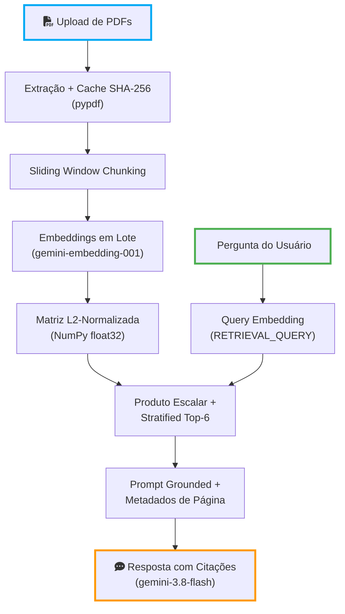

# SmartDoc Auditor

[](https://smartdoc-auditor.streamlit.app)

Aplicação web de **Retrieval-Augmented Generation (RAG)** construída do zero em Python puro, NumPy e Google Gemini API para auditoria e consulta de documentos técnicos em PDF (resoluções regulatórias, editais universitários, contratos societários e regulamentos de FIDC), com fundamentação estrita e citação exata da página de origem (`[Página X]`).

## Testar Online (Sem Instalação)

A aplicação está publicada gratuitamente no **Streamlit Community Cloud** e pode ser testada diretamente pelo navegador, sem necessidade de configurar ambiente local ou chave de API própria:

👉 **Acesse aqui:** [https://smartdoc-auditor.streamlit.app](https://smartdoc-auditor.streamlit.app)

1. Na barra lateral (**Base de Documentos**), envie um ou mais arquivos PDF com texto digital selecionável.
2. Clique em **Processar Documentos** e aguarde a indexação dos trechos.
3. Envie perguntas pontuais ou comparativas entre múltiplos documentos no chat.
4. Abaixo de cada resposta, clique em **"Ver trechos originais recuperados pelo RAG"** para inspecionar os 6 trechos exatos utilizados e o score de Similaridade de Cosseno de cada um.

---

## Motivação e Decisões de Engenharia

Em vez de encapsular o pipeline em frameworks de abstração pesada (como LangChain ou LlamaIndex), o **SmartDoc Auditor** implementa explicitamente todas as etapas matemáticas e algorítmicas do fluxo de recuperação semântica:

- **Chunking determinístico com preservação de palavras:** janela deslizante (*sliding window*) com sobreposição configurável (`chunk_size=2000`, `overlap=250`) ajustada aos limites de espaço em branco para evitar truncamento lexical e preservar contexto entre parágrafos.
- **Embeddings Assimétricos (`gemini-embedding-001`) e Cache SHA-256:** indexação do corpus com `task_type="RETRIEVAL_DOCUMENT"`, vetorização das consultas com `task_type="RETRIEVAL_QUERY"`, empacotamento dinâmico de lotes (`MAX_BATCH_CHARS=50_000`) e cache em memória por hash criptográfico do arquivo para evitar reprocessamento redundante.
- **Busca Vetorial Exata com Diversificação por Fonte (Stratified Top-6):** normalização $\ell_2$ dos vetores na indexação, reduzindo o cálculo de Similaridade de Cosseno a um produto matriz-vetor (`matrix @ query_vec`) em `float32`, combinado com seleção *Round-Robin* filtrada por limiar relativo (`DIVERSITY_RATIO=0.85`) para equilibrar múltiplos documentos em consultas comparativas sem injetar ruído em consultas específicas.
- **Resiliência e Geração Anti-Alucinação:** inferência via `gemini-3.8-flash` (com *Exponential Backoff*, controle automático de *Rate Limit* e *fallback* transparente para `gemini-3.5-flash-lite`), operando em temperatura baixa (`0.1`) sob instrução de sistema restritiva que exige citações `[Página X]` e recusa extrapolação fora do contexto recuperado.

## Arquitetura do Pipeline




## Estrutura do Projeto

```text
SmartDoc Auditor/
├── app.py              # Interface interativa em Streamlit e gestão de estado da sessão
├── rag_engine.py       # Pipeline de extração, chunking, embeddings, busca vetorial e geração
├── requirements.txt    # Dependências enxutas do projeto
├── .env.example        # Modelo de variáveis de ambiente para execução local
└── .gitignore
```

## Execução Local (Para Desenvolvedores)

### 1. Pré-requisitos

- Python 3.10+
- Chave de API do [Google AI Studio](https://aistudio.google.com/apikey)

### 2. Instalação

```bash
python -m venv .venv

# Windows (PowerShell)
.\.venv\Scripts\Activate.ps1

# Linux / macOS
source .venv/bin/activate

pip install -r requirements.txt
```

### 3. Configuração de Ambiente

Copie o arquivo de exemplo e configure sua chave no `.env`:

```bash
cp .env.example .env
```

Variáveis suportadas no `.env` (ou em `Secrets` no Streamlit Community Cloud):

| Variável | Padrão | Descrição |
| :--- | :--- | :--- |
| `GEMINI_API_KEY` | — | Chave de autenticação da Gemini API |
| `GEMINI_EMBEDDING_MODEL` | `gemini-embedding-001` | Modelo de embeddings vetoriais |
| `GEMINI_MODEL` | `gemini-3.8-flash` | Modelo generativo principal |
| `GEMINI_FALLBACK_MODEL` | `gemini-3.5-flash-lite` | Modelo de contingência para picos de demanda |

### 4. Inicialização

```bash
streamlit run app.py
```

## Licença

Distribuído sob a licença MIT.
